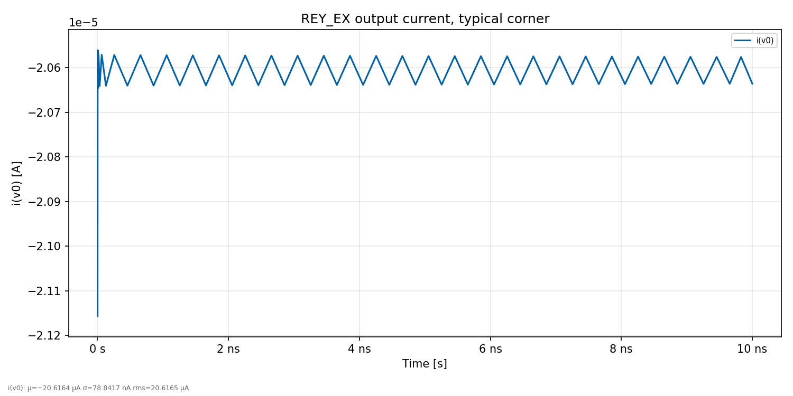
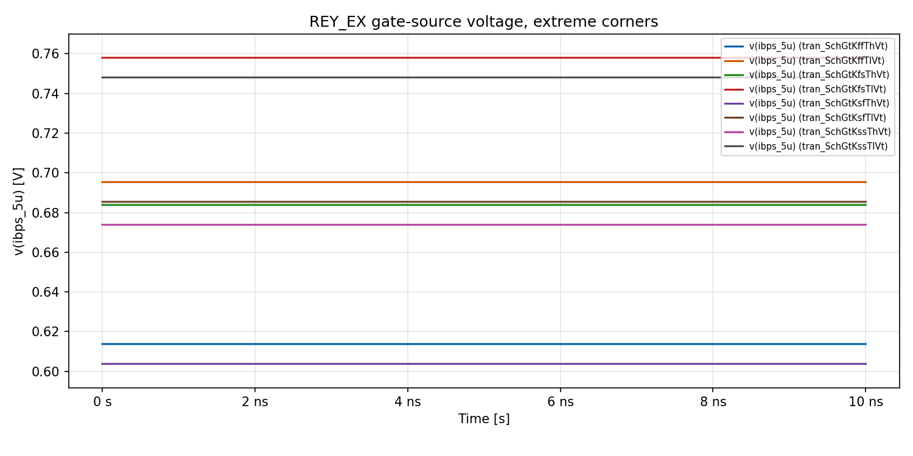
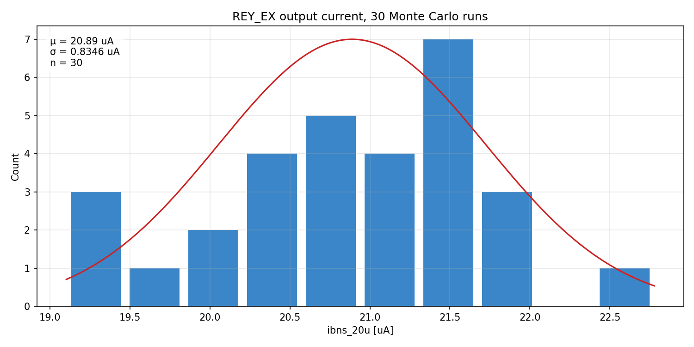
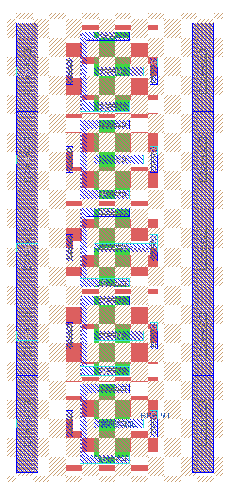
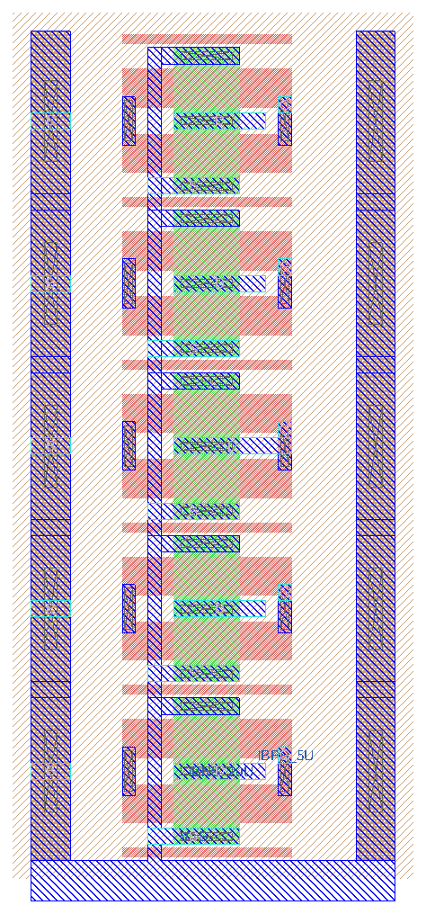
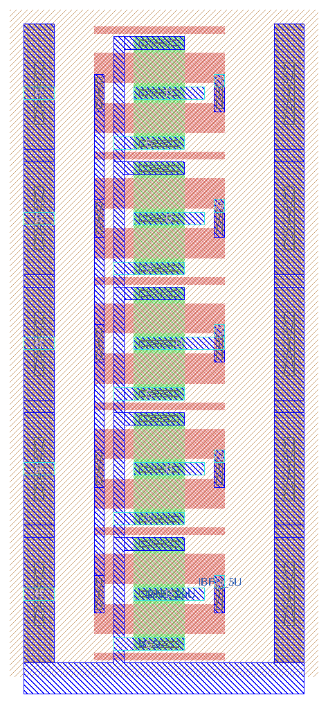
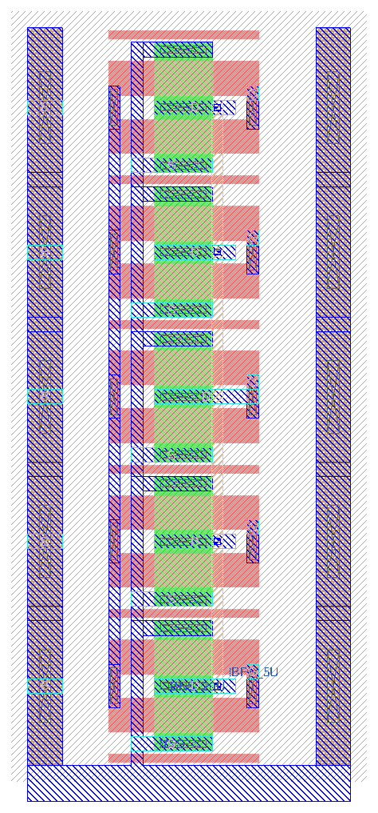

footer: Carsten Wulff 2025
slidenumbers:true
autoscale:true
theme: Plain Jane, 1
text:  Helvetica
header:  Helvetica
date: 2025-10-26

<!--pan_title: Sky130nm tutorial-->

<!--pan_doc:

**Keywords:** IP, xschem, Symbol, ngspice, cicwave, Corners, Layout, DRC, LVS, LPE, Documentation

-->

Before you start the tutorial you need to have the tools installed. 

If you're a student of mine, then you must install the tools locally on your PC.
Read check [The Tools](https://analogicus.com/aic2027/the_tools) chapter first.

If you're the impatient kind, then check <https://analogicus.com/aicex/> which
shows how to start the docker image. 

<iframe width="560" height="315" src="https://www.youtube.com/embed/8VkmzaZebnc?si=Y7ziwT6FGafCHC6j" title="YouTube video player" frameborder="0" allow="accelerometer; autoplay; clipboard-write; encrypted-media; gyroscope; picture-in-picture; web-share" referrerpolicy="strict-origin-when-cross-origin" allowfullscreen></iframe>

# Create the IP 

I've made some scripts to automatically generate the IP. 

To see what files are generated, see `tech_sky130A/cicconf/rey.yaml`

```bash
cd aicex/ip
cicconf newip ex --project rey --technology sky130A --ip  tech_sky130A/cicconf/rey.yaml
```

# The file structure 
    
It matters how you name files, and store files. I would be surprised if you 
had a good method already, as such, I won't allow you to make your own folder
structure and names for things. I also control the filenames and folder
structure because there are many scripts to make your life easier (yes, really)
that rely on an exact structure. Don't mess with it. 

## Github workflows

On github it's possible use something called workflows to run things every time
you push a new version. It's really nice, since it can then check that
your design is valid. 

The workflows are defined below. 

```bash
.github
   workflows  
   docs.yaml # Generate a github page 
   drc.yaml  # Run Design Rule Checks 
   gds.yaml  # Generate a GDS file from layout 
   lvs.yaml  # Run Layout Versus Schematic 
             # and Layout Parasitic Extraction
```

## Configuration files 

Each IP has a few files that define the setup, you'll need to modify at least
the `README.md` and the `info.yaml`.

```bash
 .gitignore  # files that are ignored by git
 README.md   # Frontpage documentation 
 config.yaml # What libraries are used. Used by  cicconf
 info.yaml   # Setup names, authors etc 
 media       # Where you should store images for documentation
 tech -> ../tech_sky130A  # The technology library
``` 

## Design files 

A "cell" in the open source EDA world should consist of the following files

- Schematic (.sch)
- Symbol (.sym)
- Layout (.mag)
- Documentation (.md)

The files must have the same name, and must be stored in `design/<LIB>/` as
shown below. 

Note there are also two symbolic links to other libraries. These two libraries
contain standard cells and standard analog transistors (ATR) that you should be using.

```bash
design
  REY_EX_SKY130A
  REY_EX.sch
  REY_ATR_SKY130A -> ../../rey_atr_sky130a/design/REY_ATR_SKY130A
  REY_TR_SKY130A -> ../../rey_tr_sky130a/design/REY_TR_SKY130A
```

For example, if the cell name was `REY_EX`, then you would have 

- `design/REY_EX_SKY130A/REY_EX.sch`: Schematic (xschem)
- `design/REY_EX_SKY130A/REY_EX.sym`: Symbol (xschem)
- `design/REY_EX_SKY130A/REY_EX.mag`: Layout (Magic)
- `design/REY_EX_SKY130A/REY_EX.md` : Markdown documentation (any text editor)

All these files are text files, so you can edit them in a text editor, but
mostly you shouldn't (except for the Markdown)

## Simulations 

All simulations shall be stored in `sim`. Once you have a Schematic ready for
simulation, then 

```bash 
cd sim 
make cell CELL=REY_EX
```
This will make a simulation folder for you. Repeat for all your cells. 

```bash
sim
  Makefile
  cicsim.yaml -> ../tech/cicsim/cicsim.yaml
```


## The work 

All commands (except for simulation), shall be run in the `work` folder. 

In the `work/` folder there are startup files for Xschem (xschemrc) and Magic (.magicrc).
They tell the tools where to find the process design kit, symbols, etc. At some point you probably
need to learn those also, but I'd wait until you feel a bit more comfortable.


```bash 
work
 .magicrc
 Makefile
 mos.24bit.dstyle -> ../tech/magic/mos.24bit.dstyle
 mos.24bit.std.cmap -> ../tech/magic/mos.24bit.std.cmap
 xschemrc
```

# Github setup

Create a repository on [github](https://github.com).
The name of the repository that you make on GitHub has to be the same as what is written after ```<your username>``` in the last command below. In this example, that is ```rey_ex_sky130a```.


``` bash
cd rey_ex_sky130a
git remote add origin \
 git@github.com:<your username>/rey_ex_sky130a.git
```

# Start working 

## Edit README.md

Open README.md in your favorite text editor and make necessary changes.

## Familiarize yourself with the Makefile and make

I write all commands I do into a Makefile. There is nothing special with a Makefile, it's just what I choose
to use 20 years ago. I'm not sure I'd choose something different now.

``` bash
cd work
make
```

Take a look inside the file called Makefile.

# Draw Schematic <a name="sch"></a>

The block we'll make is a current mirror with a 1 to 4 scaling. 

A schematic is how we describe the connectivity, and the types of devices in an
analog circuit. The open source schematic editor we will use is XSchem.

Open the schematic:

```bash
xschem -b ../design/REY_EX_SKY130A/REY_EX.sch &
```

## Add Ports

The template has three ports. Keep VSS, and delete VDD\_1V8 and PWRUP\_1V8,
since a current mirror has no supply.

Add IBPS\_5U and IBNS\_20U ports, the P and N in the name signifies what
transistor the current comes from. So IBPS must go into a diode connected NMOS,
and N will be our output, and go into a diode connected PMOS somewhere else.

## Add transistors

Use 'I' or 'Shift+i' (note the letter case) to open the library manager. Click the `rey_ex_sky130a/design`
path, then `REY_ATR_SKY130A` and select `REYATR_NCH_4C5F0.sym`

The naming convention for these transistors is `<number of contacts on
drain/source>C<times minimum gate length>F`, so the number before the C is the width,
and the number before/after the F is the length. The absolute size does not matter for now.
Just think "4C5F0 is a 4 contact wide long transistor", while a "4C1F2 is a 4
contact wide, short transistor".

Select the transistor and press 'c' to copy it, while dragging, press 'shift-f'
to flip the transistor so our current mirror looks nice. 'shift-r' rotates the
transistor, but we don't want that now.

Place two transistors for the output transistor, as shown in the figure below.

Press ESC to deselect everything

Select the input transistor, and change the name to 'xo1'

Select the first output transistor, and change the name to 'xo0[1:0]'. Using bus
notation on the name will create 2 transistors.

Select the second output transistor and give it the name 'xo2[1:0]'.

Select ports, and use 'm' to move the ports close to the transistors.

Press 'w' to route wires.

Use 'shift-z' and z, to zoom in and out

Use 'f' to zoom full screen

Remember to save the schematic


<!--pan_doc:
<sub>Figure 1: The finished REY_EX schematic - one diode connected input instance and two output instances of two devices each, between the IBPS_5U, IBNS_20U and VSS ports. Four output devices to one input device is where the 5 uA in and 20 uA out of the port names comes from</sub>
-->

## Netlist schematic

Check that the netlist looks OK

In work/
``` bash
make xsch CELL=REY_EX
cat xsch/REY_EX.spice
```

## Make a symbol

The schematic describes what is inside a cell. The symbol describes the cell
from the outside: its name, its pins, and how it should be netlisted. A parent
schematic only ever places the symbol, so without one, nobody can use your cell.

With the schematic open, press 'a' (Symbol -> Make symbol from schematic).
Xschem writes `design/REY_EX_SKY130A/REY_EX.sym`, next to the schematic, with a
pin for each port. Input ports go on the left, and output ports go on the right.

The symbol is a text file.

``` bash
cat ../design/REY_EX_SKY130A/REY_EX.sym
```

The first lines say how to netlist it

```
K {type=subcircuit
format="@name @pinlist @symname"
template="name=x1"
}
```

- `type=subcircuit`: the instance is an X line that calls the `.subckt` made from
  the schematic.
- `format`: how to write that line. Instance name, then the nets on the pins, then
  the cell name.
- `template`: the default instance name.

Each pin is a small box on layer 5, which has the name of a port in the schematic

```
B 5 -152.5 -12.5 -147.5 -7.5 {name=IBPS_5U dir=in}
```

The names must match the ports exactly, that is how the netlist finds the
connection. The other lines, `L`, `P` and `T`, are lines, the outline and text.
They only change how the symbol looks, so edit them if you want a nicer picture.

Make the symbol again every time you add, remove or rename a port. Press 'a', and
accept the question about overwriting.

To use the cell, open another schematic, press 'Shift+i', and select
`REY_EX_SKY130A/REY_EX.sym`. Select the instance and press 'e' to go down into the
schematic. 'Ctrl+e' takes you back up.

---

# Typical corner SPICE simulation <a name="simschtyp"></a>

I've made [cicsim](https://github.com/wulffern/cicsim) that I use to run simulations (ngspice) and extract
results

## Setup simulation environment
Navigate to the `rey_ex_sky130a/sim/` directory.

Make a new simulation folder

``` bash
cicsim simcell  REY_EX_SKY130A REY_EX \
    ../tech/cicsim/cell_spice/template.yaml
```

I would recommend you have a look at the template.yaml file to understand what happens.

## Familiarize yourself with the simulation folder

I've added quite a few options to cicsim, and it might be confusing. For
reference, these are what the files are used for

| File         | Description                                       |
|--------------|---------------------------------------------------|
| Makefile     | Simulation commands                               |
| cicsim.yaml  | Setup for cicsim                                  |
| summary.yaml | Generate a README with simulation results         |
| tran.meas    | Measurement to be done after simulation           |
| tran.py      | Optional python script to run for each simulation |
| tran.spi     | Transient testbench                               |
| tran.yaml    | What measurements to summarize                                                   |


The default setup should run, so

``` bash
cd REY_EX
make typical
```

## Modify default testbench (tran.spi)

Delete the VDD source

Add a current source of 5uA, and a voltage source of 1V to IBNS_20U

``` spice
IBP 0 IBPS_5U dc 5u
V0  IBNS_20U 0 dc 1
```

Save the current in V0 by adding i(V0) to the save statement in the testbench

Save the voltage by adding v(IBPS_5U) to the save statement

```spice 
.save i(V0) v(IBPS_5U)
```

## Modify measurements (tran.meas)

Add measurement of the current and VGS. It must be added between the
"MEAS_START" and "MEAS_END" lines.

``` spice
let ibn = -i(v0)
meas tran ibns_20u find ibn at=5n
meas tran vgs_m1 find v(ibps_5u) at=5n
```

Run simulation

``` bash
make typical
```
and check that the output looks okish. 

Try to run the simulation again 

``` bash
make typical
```

If everything works, then the simulation now should **not** be run. Every time
cicsim runs (provided the `sha: True` option is set in `cicsim.yaml`) cicsim will 
compute a SHA hash of all files (stored in output_tran/*.sha*) that is
referenced in the `tran.spi`. Next time cicsim is run, it checks the hash's and
does not re-run if there is no need (no files changed). 

Sometimes you want to force running, and you can do that by 

```bash 
make typical OPT="--no-sha"
```
 
Often, it's the measurement that I get wrong, so instead of rerunning simulation every time
I've added a "--no-run" option to cicsim. For example

``` bash
make typical OPT="--no-run"
```

will skip the
simulation, and rerun only the measurement. This is why you should split the testbench and the
measurement. Simulations can run for days, but measurement takes seconds.

## Modify result specification (tran.yaml)

Add the result specifications, for example

``` yaml
ibn:
  src:
    - ibns_20u
  name: Output current
  min: -5%
  typ: 20
  max: 5%
  scale: 1e6
  digits: 3
  unit: uA

vgs:
  src:
    - vgs_m1
  name: Gate-Source voltage
  typ: 0.6
  min: 0.3
  max: 0.8
  scale: 1
  digits: 3
  unit: V
```

Re-run the measurement and result generation

``` bash
make typical OPT="--no-run"
```

Open `results/tran_Sch_typical.html`


## Check waveforms

I've made [cicwave](https://github.com/wulffern/cicwave) to look at waveforms. You
can also use ngspice, or something I don't know about.

Open the raw file with 

``` bash
cicwave output_tran/tran_SchGtKttTtVt.raw 
```

Double click `i(v0)` in the list of waves to plot it. Double click it again to remove it.

There's not much happening, since all the sources are DC. The current is negative
because ngspice counts current into the positive terminal of V0 as positive, and
here it comes out, which is why `tran.meas` has the minus sign.

### Save the view

Press Ctrl+S (File -> Save Session), and save as `typical.cicwave.yaml`. A session
is a text file that says which files and waves you looked at, so you don't have to
click again. It looks like this

```yaml
files:
- path: output_tran/tran_SchGtKttTtVt.raw
plots:
- name: REY_EX output current, typical corner
  title: REY_EX output current, typical corner
  ylabel: i(v0) [A]
  waves:
  - file: 0
    name: i(v0)
```

Open it again with `cicwave --session typical.cicwave.yaml`, or skip the window and
make a figure for your report. The file ending selects PNG, SVG or PDF.

```bash
cicwave --session typical.cicwave.yaml --export typical.png
```



<!--pan_doc:
<sub>Figure 2: The output current in the typical corner, exported from cicwave. The current is 20.6 uA. The ripple is about 50 nA, and nothing in the circuit drives it. It comes from the simulator, with reltol=1e-3 in tran.spi. With reltol=1e-6 it's gone</sub>
-->

Always ask where a wiggle comes from. This one is the simulator, not the circuit.

### Searching waveforms

On the left side of the window you'll see a text box in the middle between the
filename, and the wave names. This is a regex search field, and you can easily
search for waveforms (like `i(v0)`) that you want to find. 

Note that the search field uses [regular expressions](https://en.wikipedia.org/wiki/Regular_expression). If you don't know regex,
then it's time to learn. I always use the perl regular expression variants.

For example, searching for "i(v0)" won't actually show anything, because the
`()` are special characters. "i\(v0\)" will find it though.

I could search for both ibps and v0 at the same time with `ibps|i\(`, so it's
well worth learning. 

A great resource is [Mastering Regular Expressions](https://regex.info/book.html)

---

# All corners SPICE simulations <a name="simschcorner"></a>

Analog circuits must be simulated for all physical conditions, we call them corners.
We must check high and low temperature, high and low voltage, all process corners, and device-to-device mismatch.


## Remove Vh and Vl corners (Makefile)

For the current mirror we don't need to vary voltage, since we don't have a VDD.

Open Makefile in your favorite text editor.

Change all instances of "Vt,Vl,Vh" and "Vl,Vh" to Vt


## Run all corners
To simulate all corners do

``` bash
make typical etc mc
```

where etc is extreme test condition and mc is monte-carlo.

Wait for simulations to complete.


## Get creative with python

Open `tran.py` in your favorite editor, try to read and understand it.

The `name` parameter is the corner currently running, for example `tran_SchGtAmcttTtVt`.

The measured outputs from ngspice will be added to `tran_SchGtAmcttTtVt.yaml`

Delete the "return" line.

Add the following lines, before the "Save new yaml file" comment (they write a
session for each corner, and use cicwave to plot the output current)

```python
import os
import subprocess
session = {"files": [{"path": os.path.basename(name) + ".raw"}],
           "plots": [{"waves": [{"file": 0, "name": "i(v0)"}]}]}
fsession = name + ".cicwave.yaml"
with open(fsession, "w") as fo:
  yaml.dump(session, fo)
fname = name + ".png"
print(f"Saving {fname}")
subprocess.run(["cicwave", "--session", fsession, "--export", fname], check=True)
```

Re-run measurements to check the python code

```bash
make typical etc mc OPT="--no-run"
```

You'll see that cicwave writes all the png's. Check with `ls -l output_tran/*.png`.

You'll also notice it will slow down the simulation, so maybe remove the lines
from `tran.py` again ;-) 

## Compare corners in cicwave

A table gives you the numbers, while a plot shows you the pattern. Open all the
extreme corners at the same time.

```bash
cicwave output_tran/tran_SchGtK[fs][fs]T*Vt.raw
```

Each file is listed at the top left. Select a file, and double click `v(ibps_5u)`. Repeat
for all the files. Save the session as `etc.cicwave.yaml`, and make a figure.

```bash
cicwave --session etc.cicwave.yaml --export etc.png
```



<!--pan_doc:
<sub>Figure 3: The gate-source voltage in the 8 extreme corners, from 0.60 V to 0.76 V. The cold corners (Tl) are above the hot corners (Th) of the same process, since the threshold voltage increases when it gets cold</sub>
-->

For Monte Carlo we don't care about each run, we care about the distribution. Open
the measurements instead of the waveforms. Cicsim wrote them to a CSV file, with one
row for each run.

```bash
cicwave results/tran_Sch_mc.csv
```

Right click `ibns_20u` in the list of waves, and select Histogram.

To make a figure, save a session as `mc.cicwave.yaml`. The measurements are already
scaled to uA by the `scale` in `tran.yaml`, so tell cicwave the unit.

```yaml
files:
- path: results/tran_Sch_mc.csv
plots:
- name: Monte Carlo
  title: REY_EX output current, 30 Monte Carlo runs
  analysis: histogram
  unit: uA
  waves:
  - file: 0
    name: ibns_20u
```

```bash
cicwave --session mc.cicwave.yaml --export mc.png
```



<!--pan_doc:
<sub>Figure 4: The distribution of the output current in the 30 Monte Carlo runs, exported from cicwave. The mean is 20.89 uA, and the standard deviation is 0.83 uA. The red line is a Gaussian with the same mean and standard deviation, scaled to the tallest bar. The specification is 19 uA to 21 uA, and 15 of the 30 runs are outside</sub>
-->

Thirty runs is a coarse histogram, so don't read too much into each bar. Try
`--count 100` for the `mc` target in the Makefile, and see how the shape changes.

## Generate simulation summary

Run

``` bash
make summary
```

Install [pandoc](https://pandoc.org) if you don't have it

Run

``` bash
pandoc -s --metadata title="REY_EX" README.md -o README.html
```

to generate a web page. Open the HTML file in a browser.

## Viewing results without GUI browser 

If you're on a system without a browser, or indeed a GUI, then it's possible to
view the results in the terminal.

Check if `lynx` is installed, if it's not installed, then 

On linux
```bash
sudo apt-get install lynx
```

On Mac
```bash
brew install lynx
```

Then 

```bash
lynx README.html
```

## Think about the results

From the corner and mismatch simulation, we can observe a few things.

- The typical value is not 20 uA. This is likely because we have a M2 VDS of 1 V, which is not the same
  as the VDS of M1. As such, the current will not be the same.
- The statistics from 30 corners show that when we add or subtract 3 standard deviation from the mean,
  the resulting current is outside our specification of +- 5 %. 
- The extreme corners move VGS by 150 mV, but the current only from 20.47 uA to
  20.73 uA, because the input and the output transistors move together. Mismatch
  is the opposite, it moves them apart, so that's what sets the accuracy of a current mirror.

---

# Draw Layout <a name="layout"></a>


A foundry (the factory that makes integrated circuits) needs to know how we want
  them to create our circuit. So we need to provide them with a "layout", the
  recipe, or instruction, for how to make the circuit. Although the layout
  contains the same components as the schematic, the layout contains the
  physical locations, and how to actually instruct the foundry on how to make
  the transistors we want.

Open Magic VLSI

``` bash
cd work
magic ../design/REY_EX_SKY130A/REY_EX.mag
```

Now brace yourself, Magic VLSI was created in the 1980's. For its time it was extremely modern,
however, today it seems dated. However, it is free, so we use it.

## Magic VLSI

Try google for most questions, and there are youtube videos that give an intro.

- [Magic Tutorial 1](https://www.youtube.com/watch?v=ORw5OaY33A4&t=9s)
- [Magic Tutorial 2](https://www.youtube.com/watch?v=NUahmUtY814)
- [Magic Tutorial 3](https://www.youtube.com/watch?v=OKWM1D0_fPI)
- [Magic command
  reference](http://opencircuitdesign.com/magic/commandref/commands.html)
- [Magic Documentation](https://analogicus.com/magic/)

Default magic start with the BOX tool. Mouse left-click to select bottom corner,
left-click to select top corner.

Press "space" to select another tool (WIRING, NETLIST, PICK).

Type "macro help" in the command window to see all shortcuts

| Hotkey      | Function                          |
|-------------|-----------------------------------|
| v           | View all                          |
| shift-z     | zoom out                          |
| z           | zoom in                           |
| x           | look inside box (expand)          |
| shift-x     | don't look inside box  (unexpand) |
| u           | undo                              |
| d           | delete                            |
| s           | select                            |
| Shift-Up    | Move cell up                      |
| Shift-Down  | Move cell down                    |
| Shift-Left  | Move cell left                    |
| Shift-Right | Move cell right                   |


## Add transistors

Open Cell -> Place Instance. Navigate to the right transistor.

Place it. Hover over the transistor and select it with 's'. Now comes a bit of
tedious thing. Select again, and copy. It's possible to align the transistors
on-top of eachother, but it's a bit finicky.

Place all transistors on top of each other as shown below in the picture. 



<!--pan_doc:
<sub>Figure 5: The transistor instances stacked on top of each other, before routing. The layout figures are Magic, started in work/ so it uses the display style and colors from tech/magic</sub>
-->

## Place devices

You will find that one of the more time consuming things with analog layout is to
place the devices, and to follow the design rules from foundry. I detest tedious
work. As such, I've tried for the past 25 years to simplify analog layout. I've
not finished yet, but maybe you'll find some of the scripts useful. 

Note that the command below will override all your hard work ;-) Quit Magic
first, and never run it again once you've routed the cell, it overwrites the
routing too.

```
cd work
make xsch
cicpy sch2mag REY_EX_SKY130A REY_EX
magic ../design/REY_EX_SKY130A/REY_EX.mag
```

It stacks the five devices and writes `REY_EX.mag`, `REY_EX.cic` and `REY_EX.py`.

It also does two things you might have done by hand. The drain and gate of `xo1`
are on the same net, so it uses `REYATR_NCH_4C5F0D`, the diode connected twin of
the transistor. It also adds the three ports.

## Route with the Magic console

All the pins of a REY transistor are on locali, and the guard rings form a wall of
substrate contact on each side of the stack. That makes this a short route.

You can draw each of the rectangles below with the mouse. Left click sets the
bottom corner of the box, right click sets the top corner, and middle click on a
layer in the palette paints it. Or type the commands in the console window. I
give the commands since the exact numbers matter.

Start by looking at the layers we need, and press 'x' to expand the transistors

```tcl
see no *
see viali
see locali
see m1
```

## Add Ground

Paint a 1 um locali rail below the stack, wide enough to touch both guard rings.
Then connect the sources of all the transistors with a locali strip down to the
rail.

```tcl
box -0.48um -1.2um 8.48um -0.2um
paint locali
box 2.4um -0.2um 2.72um 19.8um
paint locali
```



<!--pan_doc:
<sub>Figure 6: The locali rail below the stack ties the guard rings and the sources of all five transistors to ground</sub>
-->

## Route Gates

Each transistor has a gate contact on each side. Connect the left ones with a
locali strip.

```tcl
box 1.76um 1.4um 2.08um 18.6um
paint locali
```

The strip does not touch the sources, there's 0.32 um between them.

We don't need to connect the drain of `xo1` to the gate, since
`REYATR_NCH_4C5F0D` already has that locali on the right side of the transistor.
The poly carries the connection across to the strip.



<!--pan_doc:
<sub>Figure 7: The gates connected by a locali strip on the left side of the stack</sub>
-->

## Drain of the output transistors

The output current comes from four drains, but `xo1` sits in the middle of the
stack, and its drain is a different net. We can't use a locali strip, so we need to
go up to metal1 and pass over `xo1`.

Put a via in the free part of each output drain, to the right of the contacts.
Then connect the vias with metal1.

```tcl
box 4.7um 1.915um 4.87um 2.085um
paint viali
box 4.7um 5.915um 4.87um 6.085um
paint viali
box 4.7um 13.915um 4.87um 14.085um
paint viali
box 4.7um 17.915um 4.87um 18.085um
paint viali
box 4.625um 1.8um 4.945um 18.2um
paint m1
save
```

There's no via in the middle transistor, so the metal1 strip stays disconnected
from the drain of `xo1`.

It's a very good idea to have direction rules for metal layers. I would
recommend that you route metal1 vertical, metal2 horizontal, metal3 vertical
etc. For locali it's usually all over the place. 



<!--pan_doc:
<sub>Figure 8: The completed REY_EX layout. The metal1 strip connects the drains of the four output transistors, and passes over the input transistor in the middle, without a via</sub>
-->

## Check the labels

All ports must be named (IBPS\_5U, IBNS\_20U, VSS). The cicpy script already put
them on the gate, drain and source of `xo0<0>`, the bottom transistor. They are on
the right nets, so we can keep them.

A port is not always where you want it. To move one, select a box on the metal, and
use "Edit->Text". Select the port button. Delete the old label first, a port number
can only be used once.

---

# Layout verification <a name="ver"></a>

The DRC can be seen directly in Magic VLSI as you draw.

To check the full design rules, and layout versus schematic, navigate to work/ and do

``` tcl
make drc cdl lvs
```

Remember to save the layout first.

If you've routed correctly, then both the DRC and the LVS should be OK.

---


# Extract layout parasitics <a name="lpe"></a>

With the layout complete, we can extract parasitic capacitance.

``` bash
make lpe
```

Check the generated netlist

``` bash
cat lpe/REY_EX_lpe.spi
```

---

# Simulate with layout parasitics <a name="simlpe"></a>

Navigate to sim/REY_EX. We now want to simulate the layout.

The default `tran.spi` should already have support for that.

Open the Makefile, and change

```bash
VIEW=Sch
```

to

```bash
VIEW=Lay
```

## Typical simuation

Run

```bash
make typical
```

## Corners
Navigate to sim/REY_EX. Run all corners again

``` bash
make all
```

## Simulation summary

Open `summary.yaml` and add the layout files.

``` yaml
      - name: Lay_typ
        src: results/tran_Lay_typical
        method: typical
      - name: Lay_etc
        src: results/tran_Lay_etc
        method: minmax
      - name: Lay_3std
        src: results/tran_Lay_mc
        method: 3std
```

Run summary again

```bash
make summary
pandoc -s --metadata title="REY_EX" README.md -o README.html
```

Open the README.html and have a look a the results. The layout should be close
to the schematic simulation. 

# Make documentation 

Make a file (or it may exists) `design/REY_EX_SKY130A/REY_EX.md` and add some
documentation of what you've made. 

Add the simulation results to your git repository to keep track. The README links
to the results. The `.gitignore` ignores them, since most generated files don't
belong in git, so these you must force.

```
git add -f sim/REY_EX/results/*.html
git add sim/REY_EX/README.md 
```

# Edit info.yaml 

Finally, let's setup the `info.yaml` so that all the github workflows run
correctly. 

Mine will look like this. 

You need to setup the url (probably something like `<your username>.github.io`)
to what is correct for you.

I've added the doc section such that the workflows will generate the docs. 

```yaml
library: REY_EX_SKY130A
cell: REY_EX
author: Carsten Wulff
github: analogicus
tagline: The answer is 42
email: carsten@wulff.no
url: analogicus.github.io
doc:
  libraries:
    REY_EX_SKY130A:
      - REY_EX
```

# Setup github pages 

Go to your GitHub repository (repo). Press Settings. Press Pages. Choose source under Build and Deployment  ->
GitHub Actions

Wait for the workflows to build. And check your github pages. 
Mine is [https://analogicus.github.io/rey_ex_sky130a/](https://analogicus.github.io/rey_ex_sky130a/).

# Frequently asked questions

*Q:*  My GDS/LVS/DRC action fails, even though it works locally. 

Sometimes the reference to the transistors in the magic file might be wrong.
Open the .mag file in a text editor and check. The correct way is 

```sh
use REYATR_NCH_4C5F0  REYATR_NCH_4C5F0_0 ../REY_ATR_SKY130A
```

It's the last `../REY_ATR_SKY130A` that sometimes is missing.

---

# Summary
<!--pan_doc:

The one-page version of this chapter:

-->

- One cell end to end: schematic and symbol in xschem, a testbench, corners with cicsim, then layout, DRC, LVS and a simulation of the extracted netlist
- The names are not cosmetic: instances, ports and directories follow the aicex conventions the tools expect
- By the end you have run corners from one command - the pattern every later week repeats

Pictures by Carsten, Written by model, Approved by Carsten
